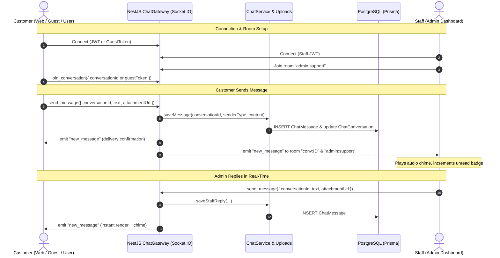

# Live Chat System & Storefront UI Refinement Implementation Plan

This implementation plan details the step-by-step engineering roadmap for building the **Real-Time Live Chat System**, cleaning up floating contact buttons, updating footer links with real data, coordinating the **Live Chat** and **Go to Top** button animations, and providing a dedicated real-time chat dashboard.

---

## 1. Scope & Core Requirements

1. **Floating Contact Buttons Cleanup:**
   - Hide the left floating WhatsApp and Messenger buttons (`WhatsAppWidget.tsx`).
   - Remove `<WhatsAppWidget />` from the storefront layout.

2. **Footer Social Links Real Data Synchronization:**
   - Ensure the footer WhatsApp and Facebook links point to verified real destinations:
     - **Facebook:** `https://www.facebook.com/bajarshodai2`
     - **WhatsApp:** `https://wa.me/8801834529197` (Number: `01834529197`)
   - Provide clean fallback URLs in `SocialIcons.tsx` so links are never dead `#` anchors.

3. **Coordinate Interaction: Floating "Go to Top" & "Live Chat" Button:**
   - **Initial State (`scrollY <= 600`):** Go-to-top button is hidden; the `LiveChatButton` rests at the primary bottom-right position (`bottom-6 right-6`).
   - **Scroll State (`scrollY > 600`):** `ScrollToTop` appears at `bottom-6 right-6`. `LiveChatButton` smoothly shifts horizontally to the left (`right-24 bottom-6`) via a fluid cubic-bezier spring transition so both buttons sit side-by-side without colliding.
   - **Return State (`scrollY <= 600`):** When the user scrolls back up, `LiveChatButton` smoothly glides back to `bottom-6 right-6`.

4. **Modern Customer Live Chat Popup Modal:**
   - Sleek floating card (`w-[380px] h-[550px] max-h-[85vh] rounded-2xl shadow-2xl`) on desktop, responsive drawer/sheet on mobile.
   - Header with store avatar, "Online" ("অনলাইন") status pulse badge, and close button.
   - Support for text messages and image/photo attachments (preview before send, compression).
   - Modern icon-only send button.
   - **Chunked 20-Message Pagination:** Loads the latest 20 messages on open; displays a smooth `"Load earlier messages"` button at the top to load the previous 20 messages incrementally.
   - **Guest Persistence & Login Merging:** Guest chat is preserved via persistent `localStorage` guest token (`bazar_guest_chat_token`). Upon user sign-in or registration, past guest conversations automatically merge into the user's account.

5. **Real-Time Backend (NestJS + Socket.IO):**
   - WebSocket Gateway (`ChatGateway`) using Socket.IO.
   - Room-based delivery (`conv:<id>` and `admin:support`).
   - Typing indicator and audio chime sound alerts.

6. **Dedicated Admin Dashboard Live Chat Page (`/live-chat`):**
   - Split-screen workspace: left panel for active conversation list with unread counters; right panel for real-time messaging, photo sending, and customer profile details.
   - Browser audio ping for incoming messages and tab title notification (`(1) New Message`).

---

## 2. Architecture & Data Flow



---

## 3. Database Schema (Strict Prisma Migration)

Following repository rules (**STRICT PROHIBITION on `prisma db push`**), migration `add_live_chat_system` will be applied via `npx prisma migrate dev --name add_live_chat_system`.

### Prisma Models (`server/prisma/schema.prisma`):

```prisma
enum ChatSenderType {
  CUSTOMER
  ADMIN
  SYSTEM
}

enum ChatConversationStatus {
  ACTIVE
  RESOLVED
  CLOSED
  ARCHIVED
}

model ChatConversation {
  id                  String                 @id @default(uuid())
  userId              String?
  user                User?                  @relation("UserChatConversations", fields: [userId], references: [id], onDelete: SetNull)
  
  guestToken          String?                @unique
  guestName           String?
  guestPhone          String?
  
  status              ChatConversationStatus @default(ACTIVE)
  lastMessageAt       DateTime               @default(now())
  lastMessageText     String?                @db.Text
  
  unreadCustomerCount Int                    @default(0)
  unreadAdminCount    Int                    @default(0)
  
  assignedAdminId     String?
  assignedAdmin       User?                  @relation("AdminAssignedChats", fields: [assignedAdminId], references: [id], onDelete: SetNull)
  
  messages            ChatMessage[]
  
  createdAt           DateTime               @default(now())
  updatedAt           DateTime               @updatedAt

  @@index([userId])
  @@index([guestToken])
  @@index([status, lastMessageAt])
}

model ChatMessage {
  id              String           @id @default(uuid())
  conversationId  String
  conversation    ChatConversation @relation(fields: [conversationId], references: [id], onDelete: Cascade)
  
  senderType      ChatSenderType
  senderId        String?
  senderName      String?
  
  text            String?          @db.Text
  attachmentUrl   String?
  attachmentType  String?
  
  isRead          Boolean          @default(false)
  readAt          DateTime?
  
  createdAt       DateTime         @default(now())

  @@index([conversationId, createdAt])
  @@index([conversationId, id])
}
```

---

## 4. Backend Implementation Plan (`server/`)

### Dependencies:
- `@nestjs/websockets`, `@nestjs/platform-socket.io`, `socket.io`

### Key Components:
1. **`ChatGateway` (`server/src/chat/chat.gateway.ts`)**:
   - Manages WebSocket lifecycle, JWT handshake verification, and fallback `x-guest-token`.
   - Rooms: `conv:<id>` for conversation participants, `admin:support` for staff.
   - Events: `subscribe_conversation`, `send_message`, `typing_start`, `typing_stop`, `mark_as_read`.
2. **`ChatService` (`server/src/chat/chat.service.ts`)**:
   - `getOrCreateConversation(userId?, guestToken?)`: Resolves existing active conversation or creates one.
   - `linkGuestConversation(userId, guestToken)`: Merges guest messages into user profile upon sign-in.
   - `getMessages(conversationId, cursor?, limit = 20)`: Cursor-based pagination for previous 20 messages.
   - `saveMessage(...)`: Persists message, updates unread counts and conversation timestamps.
3. **`ChatController` (`server/src/chat/chat.controller.ts`)**:
   - Image upload endpoint `POST /customer/chat/upload` (accepting images up to 5MB, validating MIME types, optimizing via `UploadsService`).
   - Image upload endpoint `POST /admin/chat/upload` for staff attachments.
   - Session discovery `GET /customer/chat/session`.

---

## 5. Web Frontend Implementation (`frontend/`)

### 5.1 Floating Buttons Cleanup & Real Footer Data
1. **Hide Floating Buttons:** Remove `<WhatsAppWidget />` from `frontend/app/[locale]/layout.tsx`.
2. **Footer Links (`SiteFooter.tsx` & `SocialIcons.tsx`):**
   - Facebook URL: `https://www.facebook.com/bajarshodai2`
   - WhatsApp URL: `https://wa.me/8801834529197`
   - Update default site settings in `server/src/common/settings/settings.types.ts`.

### 5.2 Floating Button Coordinate Transition (`LiveChatButton.tsx`)
- Positioned fixed at `bottom-6`.
- Dynamic style:
  - If `scrollY <= 600`: `right-6` (occupies primary corner spot).
  - If `scrollY > 600`: `right-24` (slides smoothly to the left of the `ScrollToTop` button).
- Transition: `transition: all 400ms cubic-bezier(0.16, 1, 0.3, 1)`.
- Live unread badge pulse indicator when new staff replies arrive.

### 5.3 Modern Live Chat Modal (`LiveChatModal.tsx`)
- **Dimensions & Glassmorphism:** Rounded 16px card (`w-[380px] h-[550px] max-h-[85vh]`) with backdrop blur and soft shadow.
- **Header:** Shop avatar, "সাপোর্ট টিম অনলাইন" pulse badge, close button.
- **Feed with 20-Message Pagination:**
  - Loads latest 20 messages on open.
  - "Load earlier messages" (`আগের বার্তা দেখুন`) button at top loads previous 20 messages without jumping scroll position.
  - Distinct styling for customer vs agent messages.
  - Photo attachment viewer with lightbox.
- **Composer Bar:**
  - Auto-growing input field.
  - Photo attachment button with preview thumbnail and remove button.
  - **Modern icon-only send button** (Paper airplane `Send` icon).
  - Enter key inserts a newline (goes to the next line); must click the send button to send.

---

## 6. Admin Dashboard Implementation (`dashboard/`)

1. **Route & Navigation:**
   - Dedicated route: `/live-chat` in `dashboard/src/router.tsx`.
   - Sidebar item under Customer Care with unread counter badge.
2. **Two-Panel Workspace (`LiveChatPage.tsx`):**
   - **Left Panel (Conversations List):** Real-time list of customer chats, search by customer name/phone/text, unread count badges, automatic sort on new messages.
   - **Right Panel (Active Conversation):** Customer header, 20-message scroll history, image attachment view, quick response snippets, photo upload button, and send icon button.
   - **Notification Sound:** Subtle chime audio alert on incoming customer messages.

---

## 7. Cross-Platform Parity (`bazar-shodai-app`)

- Structure created to support mobile live chat (`app/chat/index.tsx`) using the same backend endpoints and Socket.IO protocol.
- Guest tokens stored in `AsyncStorage` and linked upon mobile user sign-in.

---

## 8. Step-by-Step Execution Plan

1. **Phase 1 (Immediate UI cleanups):** Hide left floating widget & update footer social links with real data.
2. **Phase 2 (Database migration):** Generate and run Prisma migration `add_live_chat_system`.
3. **Phase 3 (Backend):** Install Socket.IO dependencies, implement `ChatGateway`, `ChatService`, and upload endpoints.
4. **Phase 4 (Frontend Storefront):** Implement `LiveChatButton` with dynamic scroll animation and `LiveChatModal` with 20-message chunks and photo attachments.
5. **Phase 5 (Dashboard):** Implement `/live-chat` page with real-time socket connection, sound alerts, and quick responses.
6. **Phase 6 (Verification):** Run typechecks and unit tests across all three codebases (`frontend`, `server`, `dashboard`).
