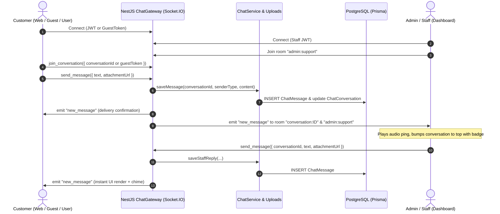

# Live Chat System & UI Refinement Implementation Plan

This document outlines the complete architectural, database, backend, frontend, and dashboard plan for the **Real-Time Live Chat System**, along with the floating contact button adjustments and footer social link synchronization for Bazar Shodai.

---

## 1. Executive Summary & Goals

### Key Objectives
1. **Remove Left Floating Buttons:** Hide the floating WhatsApp and Messenger buttons at the bottom-left (`WhatsAppWidget.tsx`) as requested.
2. **Real Data for Footer Social Links:** Ensure footer Facebook and WhatsApp links point to verified real destinations:
   - **Facebook:** `https://www.facebook.com/bajarshodai2`
   - **WhatsApp:** `https://wa.me/8801834529197` (Number: `01834529197`)
3. **Dynamic Floating "Go to Top" & "Live Chat" Coordinate Interaction:**
   - At page top (`scrollY <= 600`), the `LiveChatButton` rests at the primary bottom-right spot (`bottom-6 right-6`).
   - When the user scrolls down and `ScrollToTop` springs in, `LiveChatButton` smoothly shifts horizontally to the left (`right-24 bottom-6` or smooth slide to clear space) via buttery cubic-bezier / GSAP animation.
   - When scrolling back up and `ScrollToTop` hides, `LiveChatButton` smoothly transitions back to `bottom-6 right-6`.
4. **Modern Customer Live Chat Popup Modal:**
   - Sleek floating card on desktop (`w-96 h-[540px] max-h-[85vh] rounded-2xl shadow-2xl`) and responsive drawer/sheet on mobile.
   - Support for text messaging and photo attachments (with preview & thumbnail compression).
   - Message send action triggered by a clean, modern icon-only send button.
   - Chunked message pagination: loads the previous 20 messages at a time with smooth "Load earlier messages" slide animation.
   - Guest persistence (`localStorage` guest token) with automatic account merge upon user sign-in.
   - Typing indicator and subtle chime audio notification for incoming messages.
5. **Real-Time Backend (NestJS + Socket.IO):**
   - `@nestjs/websockets` + `socket.io` bidirectional gateway with rooms for conversations and admin broadcast channel.
   - Database persistence for messages, conversations, and attachments using Prisma migrations.
6. **Dedicated Admin Dashboard Live Chat Page (`/live-chat`):**
   - Dedicated split-panel interface: conversation list on left with unread badges and live sorting; active chat room on right with photo upload, customer details sidebar, and quick response templates.
   - Real-time browser audio alert and unread tab badge.
7. **Cross-Platform Mobile Parity (`bazar-shodai-app`):**
   - Architecture designed to support mobile app chat (`app/chat/index.tsx`) using the exact same WebSocket & REST endpoints.

---

## 2. System Architecture & Data Flow



---

## 3. Database Schema (Prisma Migration)

Following repository rules (**STRICT PROHIBITION on `prisma db push`**), all schema changes will be applied using `npx prisma migrate dev --name add_live_chat_system`.

### Prisma Schema Additions (`server/prisma/schema.prisma`):

```prisma
enum ChatSenderType {
  CUSTOMER
  ADMIN
  SYSTEM
}

enum ChatConversationStatus {
  ACTIVE
  RESOLVED
  CLOSED
  ARCHIVED
}

model ChatConversation {
  id                  String                 @id @default(uuid())
  // Nullable if initiated by a guest before login
  userId              String?
  user                User?                  @relation("UserChatConversations", fields: [userId], references: [id], onDelete: SetNull)
  
  // Persistent crypto UUID stored in guest's browser localStorage
  guestToken          String?                @unique
  guestName           String?
  guestPhone          String?
  
  status              ChatConversationStatus @default(ACTIVE)
  lastMessageAt       DateTime               @default(now())
  lastMessageText     String?                @db.Text
  
  // Unread badge counters
  unreadCustomerCount Int                    @default(0)
  unreadAdminCount    Int                    @default(0)
  
  // Assigned staff member handling the session
  assignedAdminId     String?
  assignedAdmin       User?                  @relation("AdminAssignedChats", fields: [assignedAdminId], references: [id], onDelete: SetNull)
  
  messages            ChatMessage[]
  
  createdAt           DateTime               @default(now())
  updatedAt           DateTime               @updatedAt

  @@index([userId])
  @@index([guestToken])
  @@index([status, lastMessageAt])
}

model ChatMessage {
  id              String         @id @default(uuid())
  conversationId  String
  conversation    ChatConversation @relation(fields: [conversationId], references: [id], onDelete: Cascade)
  
  senderType      ChatSenderType
  senderId        String?        // User ID (for logged-in user or admin)
  senderName      String?        // Display name
  
  text            String?        @db.Text
  attachmentUrl   String?        // Photo / file URL
  attachmentType  String?        // MIME type (e.g. image/jpeg, image/png)
  
  isRead          Boolean        @default(false)
  readAt          DateTime?
  
  createdAt       DateTime       @default(now())

  @@index([conversationId, createdAt])
  @@index([conversationId, id])
}
```

---

## 4. Backend Implementation Plan (`server/`)

### 4.1 Required Dependencies
- `@nestjs/websockets`
- `@nestjs/platform-socket.io`
- `socket.io`
- `@types/socket.io`

### 4.2 Modules & Structure (`server/src/chat/`)
1. **`chat.gateway.ts`**:
   - WebSocket Gateway operating on namespace `/chat` with CORS enabled for frontend and dashboard origins.
   - Authentication middleware: parses JWT from handshake auth header; if absent, accepts `guestToken` UUID string.
   - Events:
     - `subscribe_conversation({ conversationId, guestToken })`: Joins socket to room `conv:<id>`.
     - `send_message({ conversationId, text, attachmentUrl })`: Validates payload, saves to database via `ChatService`, broadcasts `new_message` to the conversation room and `admin:support`.
     - `typing_start` / `typing_stop`: Broadcasts typing status to counterpart.
     - `mark_as_read({ conversationId })`: Resets unread counters and broadcasts update.
2. **`chat.service.ts`**:
   - `getOrCreateCustomerConversation(userId?: string, guestToken?: string)`: Resolves or initializes conversation.
   - `linkGuestConversation(userId: string, guestToken: string)`: Merges past guest chat history into the newly authenticated user account.
   - `getMessages(conversationId: string, cursor?: string, limit = 20)`: Returns 20 messages before the given cursor (for backward scroll pagination).
   - `saveMessage(...)`: Stores message, updates `lastMessageAt`, `lastMessageText`, and increments appropriate unread counter.
   - `getAdminConversations(filters)`: Returns active customer conversations sorted by `lastMessageAt` descending.
3. **`chat.controller.ts` (REST Fallback & File Upload)**:
   - `GET /customer/chat/session`: Fetches or creates session for current user or `x-guest-token`.
   - `GET /customer/chat/messages`: Paginated message retrieval.
   - `POST /customer/chat/upload`: Accepts image attachments (max 5MB, jpeg/png/webp), stores via `UploadsService`, and returns CDN/URL.
   - `POST /customer/chat/link-guest`: Merges guest session to user.
   - `GET /admin/chat/conversations`: Admin conversation list.
   - `POST /admin/chat/upload`: Admin image upload.

---

## 5. Web Frontend Implementation (`frontend/`)

### 5.1 Floating Buttons Cleanup & Social Links
1. **Hide Bottom-Left Floating Contact Buttons:**
   - Remove `<WhatsAppWidget />` from `frontend/app/[locale]/layout.tsx` so the floating WhatsApp & Messenger bubbles no longer display.
2. **Fix Real Links in Footer (`SiteFooter.tsx` & `SocialIcons.tsx`):**
   - Ensure `SocialIcons.tsx` defaults:
     - Facebook: `https://www.facebook.com/bajarshodai2`
     - WhatsApp: `https://wa.me/8801834529197`
   - Update `server/src/common/settings/settings.types.ts` defaults so new environments pre-populate these exact values.

### 5.2 Dynamic Coordinate Interaction: Go-To-Top & Live Chat Button
1. **Component: `frontend/components/chat/LiveChatButton.tsx`**:
   - Sits at `bottom-6` of the viewport with high `z-index` (`z-[1450]`).
   - Listens to scroll position:
     - When `scrollY <= 600` (Go-to-top hidden): Positioned at `right-6`.
     - When `scrollY > 600` (Go-to-top visible at `right-6`): Smoothly shifts to the left by `72px` (`right-24`) via smooth CSS transition `transition: transform 400ms cubic-bezier(0.16, 1, 0.3, 1), right 400ms ease`.
   - Design:
     - Emerald green brand theme (`bg-brand-fresh text-on-fresh`), rounded circle (52px x 52px) with subtle ambient shadow.
     - Chat bubble icon with live unread badge dot if customer has an unread admin reply.
     - Smooth hover scale & click ripple.

### 5.3 Modern Customer Live Chat Window (`LiveChatModal.tsx`)
1. **Window Layout**:
   - Positioned in bottom-right (`bottom-20 right-6` on desktop, bottom sheet / full-screen drawer on mobile).
   - Card dimensions: `w-[380px] h-[550px] max-h-[85vh]` with rounded-2xl glass-card styling and backdrop shadow.
2. **Header**:
   - Store branding, green pulsing "Online" indicator ("সাপোর্ট টিম অনলাইন").
   - Close / minimize icon button.
3. **Message Thread (Chunked 20-Message Loading)**:
   - On open: Fetches latest 20 messages.
   - If more than 20 messages exist: Displays a top banner / button: `"আগের বার্তা দেখুন" / "Load earlier messages"`.
   - Clicking smoothly loads preceding 20 messages and maintains scroll anchor position without jumping.
   - Message Bubbles:
     - Customer: right-aligned, brand fresh background, white text, timestamp.
     - Support Agent: left-aligned, card background with border, avatar, timestamp.
     - Photo messages: inline rounded image preview with click-to-zoom lightbox.
4. **Input & Attachment Bar**:
   - Multi-line expandable text area (Enter to send, Shift+Enter for newline).
   - Attachment button (Paperclip/Image icon): triggers hidden file input; validates image type and file size (< 5MB); displays thumbnail preview with remove (X) button before sending.
   - **Send Button**: Clean icon-only send button (`Send` / Paper airplane icon) styled with brand green, disabled when input is empty and no attachment is present.
   - Typing indicator broadcast on keypress.
5. **Guest State & Account Sync**:
   - Generates and stores `bazar_guest_chat_token` in `localStorage`.
   - When customer logs in via auth modal or page, an event triggers `linkGuestConversation`, merging previous guest messages into their user profile.

---

## 6. Admin Dashboard Implementation (`dashboard/`)

### 6.1 Route & Navigation
- New Route: `/live-chat` in `dashboard/src/router.tsx`.
- Sidebar Item: `Live Chat` under Customer Care section with a live unread message badge count.

### 6.2 Split-Screen Interface (`LiveChatPage.tsx`)
1. **Left Panel: Conversation Feed**:
   - Real-time list of all active conversations.
   - Search bar: search by customer name, phone, or message text.
   - Filters: Active, Unresolved, All.
   - Real-time sort: any incoming message brings the conversation to the top with a highlighted badge and audio chime.
2. **Right Panel: Chat Workspace**:
   - Top Bar: Customer profile summary (Name, Phone number, "Guest" or "Registered Customer", Link to customer order history).
   - Chat Canvas:
     - Message bubbles with staff vs customer distinction.
     - 20-message chunk pagination.
     - Image attachment rendering with click-to-enlarge.
   - Bottom Reply Bar:
     - Quick canned responses ("ধন্যবাদ, আমরা দ্রুত চেক করছি", "আপনার অর্ডার নম্বরটি দিন", etc.).
     - Photo attachment button for staff.
     - Text input and icon-only send button.

---

## 7. Mobile App Parity Plan (`bazar-shodai-app`)

In compliance with repository guidelines:
1. Create `bazar-shodai-app/src/features/chat/`:
   - Socket connection hook `useLiveChatSocket`.
   - Dedicated Chat Screen: `app/chat/index.tsx` accessible from Help / Customer Support menu.
   - Image picking via `expo-image-picker` using the same upload endpoint.
   - Same 20-message pagination logic and guest token persistence in `AsyncStorage`.

---

## 8. Verification & Testing Strategy

1. **Backend Tests (`server/`):**
   - Unit tests for `ChatService`: test conversation creation, guest token association, user merging, and paginated message retrieval.
   - Gateway tests: test socket connection, room subscription, message broadcast, and read receipts.
2. **Frontend Tests (`frontend/`):**
   - Jest tests for `LiveChatButton` scroll interaction and coordinate animation.
   - Component test for `LiveChatModal`: rendering 20 messages, clicking "load earlier", sending message, and image preview.
   - Verify removal of floating buttons and footer link destinations.
3. **Dashboard Tests (`dashboard/`):**
   - Vitest tests for conversation list sorting, unread counter updates, and message send action.
   - Production build check: `npm --prefix dashboard run build`.
4. **Typechecks:**
   - Frontend: `node frontend/node_modules/typescript/bin/tsc -p frontend/tsconfig.json --noEmit`
   - Server: `node server/node_modules/typescript/bin/tsc -p server/tsconfig.json --noEmit`
   - Mobile: `npx tsc --noEmit` in `bazar-shodai-app/`

---

## 9. Phased Execution Roadmap

| Phase | Tasks |
|---|---|
| **Phase 1** | Hide left floating contact buttons (`WhatsAppWidget.tsx`) & fix real Facebook/WhatsApp footer links in `SiteFooter.tsx` and `SocialIcons.tsx`. |
| **Phase 2** | Database Prisma migration (`ChatConversation`, `ChatMessage`) with version-controlled migration file. |
| **Phase 3** | Backend Live Chat module: Socket.IO Gateway, `ChatService`, upload endpoints, and guest-to-user linking. |
| **Phase 4** | Web Storefront: `LiveChatButton` with dynamic scroll transition next to `ScrollToTop`, and modern `LiveChatModal` (20-message chunks, image upload, send icon button). |
| **Phase 5** | Admin Dashboard: Dedicated `/live-chat` page with split panel, real-time incoming alerts, and image support. |
| **Phase 6** | Cross-platform verification, mobile app alignment, and full test suite execution. |

