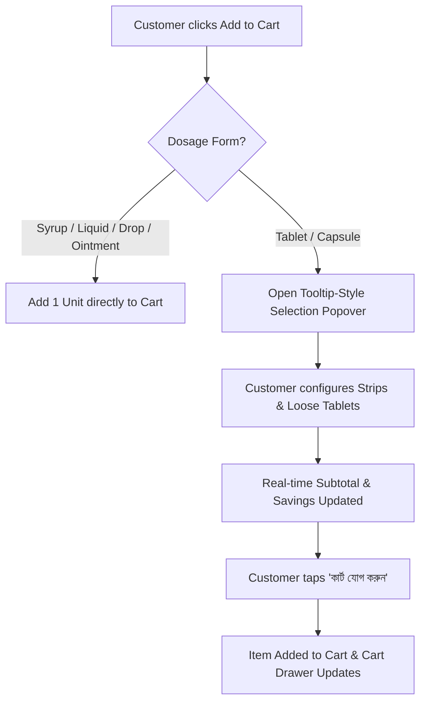
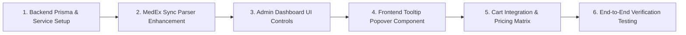

# Bulletproof Plan: Medicine Add-to-Cart, Strip/Tablet Purchase Option & Discount Architecture

---

## 1. Executive Summary & Objective

In Bangladesh, pharmaceutical buying behavior is unique:

- Customers often purchase medicine either by the **full strip / pata (পাতা)** (e.g., 10 tablets) or as **loose individual tablets/capsules (খুচরা ট্যাবলেট)** (e.g., 2, 3, or 5 tablets for a short course).
- Customers also frequently purchase a combination: e.g., **1 full pata + 3 loose tablets** (13 tablets total).
- Medicine packaging varies: while ~85% of oral solid medicines contain **10 tablets/capsules per pata**, others come in **4, 6, 14, 15, 20, or 30** tablets per pata.
- Pharmacy discount policies vary:
  - Some pharmacies apply a global discount (e.g., 8% off) across **all quantities** (even on 2 or 3 loose tablets).
  - Other pharmacies only apply discounts when purchasing at least **1 full pata (strip)**, selling loose tablets at standard MRP.
  - Store administrators must have full control to toggle this policy **globally** as well as override it for **individual medicines**.

This document outlines the end-to-end architecture across the **Database / Backend**, **Admin Dashboard**, and **Public Storefront** to deliver this functionality seamlessly and without breaking existing carts, orders, or non-medicine products.

---

## 2. Core Business Rules & Requirements Breakdown

| Requirement                | Specification                                                                                                                                                                                                                                                                             |
| :------------------------- | :---------------------------------------------------------------------------------------------------------------------------------------------------------------------------------------------------------------------------------------------------------------------------------------- |
| **Applicable Products**    | **Oral solid dosage forms ONLY** (`Tablet`, `Capsule`). Non-solids (`Syrup`, `Suspension`, `Drop`, `Ointment`, `Cream`, `Injection`, `Inhaler`) bypass this flow and add standard unit/bottle.                                                                                            |
| **Units per Pata / Strip** | Default is **10 tablets/capsules**. Can be auto-extracted from API data (`packSizeInfo`, e.g. `"1 Strip (10 Tablets)"`) and overridden manually by Admin in the Dashboard.                                                                                                                |
| **Add-to-Cart Trigger**    | Clicking the cart icon / "Add to Cart" button on any tablet/capsule triggers a small **tooltip-style popover / modal** anchored to the button (or mobile bottom sheet).                                                                                                                   |
| **Selection Options**      | 1. **Full Pata (পাতা / Strip)**: Stepper [ − ] `count` [ + ]<br>2. **Loose Tablets (ট্যাবলেট / পিস)**: Stepper [ − ] `count` [ + ]<br>3. **Combination**: e.g., 1 Pata + 3 Tablets.<br>4. Auto-rollover: Selecting `unitsPerStrip` loose tablets automatically converts into 1 full pata. |
| **Global Discount Policy** | Managed in Admin Dashboard (`siteSetting: medicine_discount_settings`):<br>• `ALL_CASES`: Discount applies to all quantities (even 1, 2, or 3 loose tablets).<br>• `MIN_STRIP_ONLY`: Discount unlocks **only** if the order includes $\ge$ 1 full pata. Once unlocked, **all tablets (both the full patas and loose tabs, e.g. all 13 tablets) receive the discount**! If order contains $< 1$ full pata (only loose tabs), no discount is applied. |
| **Per-Medicine Override**  | Admin can override discount policy per medicine in `ProductEditor` / `MedicineSync`:<br>• `INHERIT_GLOBAL` (Follow global setting)<br>• `ALL_CASES` (Always discount all quantities)<br>• `MIN_STRIP_ONLY` (Only discount if $\ge$ 1 pata; once met, discounts all tablets)<br>• `NO_DISCOUNT` (Always full MRP) |

---

## 3. Data & Schema Architecture

### 3.1. `MedicineMeta` Prisma Schema Updates (`server/prisma/schema.prisma`)

Add dedicated fields to `MedicineMeta` to track units per strip and per-medicine discount eligibility:

```prisma
model MedicineMeta {
  id           String       @id @default(uuid())
  productId    String       @unique
  product      Product      @relation(fields: [productId], references: [id], onDelete: Cascade)

  // Pharmaceutical Details
  genericName  String
  genericSlug  String
  dosageForm   String       // Tablet, Capsule, Syrup, Drop, Ointment, etc.
  strength     String       // e.g. "500 mg + 65 mg"
  manufacturer String       // e.g. "Beximco Pharmaceuticals Ltd."
  type         MedicineType @default(OTC)

  // Packaging Configuration
  unitsPerStrip Int         @default(10) // Number of tablets/capsules in 1 strip (default 10)

  // MedEx Sync Tracking
  medexUrl     String?
  medexId      Int?
  lastSyncedAt DateTime?
  syncStatus   String       @default("SYNCED")
  mrpUnit      Decimal?     @db.Decimal(10, 2) // Single tablet MRP
  mrpStrip     Decimal?     @db.Decimal(10, 2) // Single strip MRP
  mrpBox       Decimal?     @db.Decimal(10, 2) // Full box MRP
  packSizeInfo String?      // Raw text from API, e.g. "1 Strip (10 Tablets)"

  // Discount Overrides
  discountMode        String   @default("GLOBAL") // 'GLOBAL', 'PERCENT', 'FIXED', 'NONE'
  discountValue       Decimal? @db.Decimal(10, 2)
  discountEligibility String   @default("INHERIT_GLOBAL") // 'INHERIT_GLOBAL', 'ALL_CASES', 'MIN_STRIP_ONLY', 'NO_DISCOUNT'

  createdAt    DateTime     @default(now())
  updatedAt    DateTime     @updatedAt

  @@index([dosageForm])
  @@index([discountEligibility])
}
```

### 3.2. Global Settings Key (`siteSetting: medicine_discount_settings`)

Stored in the `SiteSetting` table under key `medicine_discount_settings`:

```json
{
  "globalDiscountPercent": 8.0,
  "discountEligibility": "MIN_STRIP_ONLY", // or "ALL_CASES"
  "defaultUnitsPerStrip": 10
}
```

### 3.3. API Auto-Extraction of `unitsPerStrip`

When syncing medicines from MedEx / pharmaceutical APIs:

- Parse `packSizeInfo` using regex:
  1. `/(\d+)\s*(?:Tablets?|Capsules?)/i` (e.g. `"1 Strip (10 Tablets)"` $\rightarrow 10$)
  2. `/(?:strip|pack)\s*of\s*(\d+)/i`
  3. If not found, compute `Math.round(mrpStrip / mrpUnit)` (e.g., 50 / 5 = 10).
  4. If both fail, fallback to `10`.

---

## 4. Pricing & Discount Calculation Engine

### 4.1. Price Resolution Algorithm

Given:

- Strip MRP: $P_{\text{strip}} = \text{mrpStrip}$
- Single Tablet MRP: $P_{\text{unit}} = \text{mrpUnit} \lor (P_{\text{strip}} / \text{unitsPerStrip})$
- Active Discount Percent: $D\%$ (from Global % or Medicine Custom %)
- Quantities ordered: $Q_{\text{strip}}$ (number of full strips) and $Q_{\text{tab}}$ (number of loose tablets)
- Effective Discount Eligibility $E \in \{\text{ALL\_CASES}, \text{MIN\_STRIP\_ONLY}, \text{NO\_DISCOUNT}\}$

```typescript
function calculateMedicineOrderPrice({
  stripPrice,
  unitPrice,
  unitsPerStrip,
  discountPercent,
  discountEligibility,
  stripQty,
  tabQty,
}: MedicinePricingInput) {
  // Normalize loose tablets if tabQty >= unitsPerStrip
  const totalStrips = stripQty + Math.floor(tabQty / unitsPerStrip);
  const remainingTabs = tabQty % unitsPerStrip;

  // Determine if discount applies to full strips vs loose tablets
  let stripDiscountRate = 0;
  let tabDiscountRate = 0;

  if (discountEligibility !== "NO_DISCOUNT" && discountPercent > 0) {
    if (discountEligibility === "ALL_CASES") {
      stripDiscountRate = discountPercent / 100;
      tabDiscountRate = discountPercent / 100;
    } else if (discountEligibility === "MIN_STRIP_ONLY") {
      // If customer buys at least 1 full strip, discount unlocks for ALL tablets (both strips and loose tabs!)
      if (totalStrips >= 1) {
        stripDiscountRate = discountPercent / 100;
        tabDiscountRate = discountPercent / 100; // Loose tabs ALSO get discount once min 1 strip threshold is met!
      } else {
        stripDiscountRate = 0;
        tabDiscountRate = 0; // Less than 1 strip: loose tablets stay at standard unit MRP
      }
    }
  }

  const effectiveStripPrice =
    Math.round(stripPrice * (1 - stripDiscountRate) * 100) / 100;
  const effectiveTabPrice =
    Math.round(unitPrice * (1 - tabDiscountRate) * 100) / 100;

  const stripTotal = totalStrips * effectiveStripPrice;
  const tabTotal = remainingTabs * effectiveTabPrice;
  const finalTotal = stripTotal + tabTotal;

  const originalTotal = totalStrips * stripPrice + remainingTabs * unitPrice;
  const totalSavings = originalTotal - finalTotal;

  return {
    totalStrips,
    remainingTabs,
    effectiveStripPrice,
    effectiveTabPrice,
    stripTotal,
    tabTotal,
    finalTotal,
    totalSavings,
  };
}
```

### 4.2. Example Scenarios

| Scenario               | Inputs               | Rule: `MIN_STRIP_ONLY` (8% off)       | Rule: `ALL_CASES` (8% off)               |
| :--------------------- | :------------------- | :------------------------------------ | :--------------------------------------- |
| **A: 1 Full Pata**     | 1 Strip (MRP ৳50)    | ৳50 − 8% = **৳46.00** (Save ৳4.00)       | ৳50 − 8% = **৳46.00** (Save ৳4.00)          |
| **B: 3 Loose Tabs**    | 3 Tabs (MRP ৳5 each) | 3 × ৳5 = **৳15.00** (No discount, $< 1$ pata)     | 3 × (৳5 − 8%) = **৳13.80** (Save ৳1.20)  |
| **C: 1 Pata + 3 Tabs (13 tabs)** | 1 Strip + 3 Tabs     | $\ge 1$ pata unlocked! ৳46 (strip) + ৳13.80 (tabs) = **৳59.80** (Save ৳5.20 across all 13 tabs) | ৳46 (strip) + ৳13.80 (tabs) = **৳59.80** (Save ৳5.20) |

---

## 5. Admin Dashboard Architecture

### 5.1. Global Medicine Discount Settings Screen (`dashboard/src/pages/catalog/MedicineSync.tsx`)

In the Global Medicine Settings panel:

1. **Global Discount Rate (%):** Input field, e.g. `8%`.
2. **Discount Eligibility Rule (ছাড়ের নিয়ম):**
   - 🔘 **All Cases (সব ক্ষেত্রে ছাড়):** Apply discount to all quantities (even 1, 2, or 3 loose tablets).
   - 🔘 **Minimum 1 Full Pata (কমপক্ষে ১ পাতা নিলে পুরো অর্ডারে ছাড়):** Customer must purchase at least 1 full pata ($\ge 1$) to unlock the discount. Once unlocked, **all tablets (the full pata + all loose tablets, e.g. all 13 tablets) receive the discount**. If customer orders $< 1$ pata (only loose tabs), no discount is applied.
3. **Default Units per Strip:** Input field, default `10`.
4. **"Apply Settings to All Global Medicines" Button:** Updates site settings and refreshes cached calculations.

### 5.2. Individual Medicine Product Editor (`dashboard/src/pages/products/ProductEditor.tsx`)

When editing any product in category "Medicine" with dosage form `Tablet` or `Capsule`:
Under the "Pharmaceutical Details" section:

1. **Units per Strip (প্রতি পাতায় ট্যাবলেট/ক্যাপসুল সংখ্যা):**
   - Number input (1 to 100), default `10` or extracted from MedEx.
2. **Single Tablet MRP (প্রতি পিস দাম):**
   - Input (e.g. `৳2.50`), with auto-calculate helper from strip price.
3. **Discount Eligibility Override (এই ওষুধের জন্য ছাড়ের নিয়ম):**
   - Dropdown options:
     - `Inherit Global (গ্লোবাল নিয়ম অনুযায়ী)`
     - `All Cases (খুচরা ও পাতা উভয়টিতে ছাড়)`
     - `Min 1 Full Pata Only (শুধুমাত্র ১ পাতা বা তার বেশিতে ছাড়)`
     - `No Discount (কোনো ছাড় নেই)`
4. **Interactive Pricing Preview Box:**
   - Displays real-time breakdown:
     - 1 Strip MRP $\rightarrow$ Discounted Price
     - 1 Tablet MRP $\rightarrow$ Discounted Price (or "No discount on loose")

---

## 6. Frontend Storefront Architecture

### 6.1. Flowchart of Medicine Add-to-Cart Interaction



### 6.2. Medicine Purchase Popover Component (`MedicinePurchasePopover.tsx`)

A lightweight, accessible popover (using Radix Popover or Portal):

- **Desktop:** Appears as a sleek tooltip-style popover anchored right next to the clicked card button.
- **Mobile:** Appears as a bottom sheet / drawer for frictionless finger ergonomics.
- **Contents:**
  1. **Header:** Medicine Name, Strength, Manufacturer, and Pills per Pata badge (e.g. `১০টি ট্যাবলেট / পাতা`).
  2. **Option 1 — পাতা (Full Strip):**
     - Icon: Strip representation.
     - Price per strip (with discount strike-through if applicable).
     - Stepper: `[ − ]` `1` `[ + ]`.
  3. **Option 2 — খুচরা ট্যাবলেট (Loose Tablets):**
     - Icon: Single pill.
     - Price per tablet.
     - Stepper: `[ − ]` `0` `[ + ]` (range: 0 to `unitsPerStrip - 1`).
     - Help note: _"১০টি ট্যাবলেট নিলে স্বয়ংক্রিয়ভাবে ১টি পাতা হয়ে যাবে।"_
  4. **Summary & Total Bar:**
     - Displays: `১ পাতা + ৩ টি ট্যাবলেট` $\rightarrow$ **৳৬১.০০** (৳৪ সাশ্রয়).
  5. **Action Button:** "কার্ট যোগ করুন" (Add to Cart).

### 6.3. Cart & Checkout Representation

To ensure zero breaking changes to existing order processing and database schemas:

1. In the Cart Context and Backend Cart Item:
   - The cart item stores:
     - `quantity`: Total tablets in strip-normalized format, OR:
     - Variant-based representation:
       - Line A: `Napa Extra (পাতা)` × 1
       - Line B: `Napa Extra (খুচরা ট্যাবলেট)` × 3
     - **OR** Single Line Item with Package Detail:
       - `name`: `নাপা এক্সট্রা (১ পাতা + ৩ টি ট্যাবলেট)`
       - `price`: calculated composite total
       - `quantity`: 1
2. The customer sees a clean, unmistakable breakdown in the Cart Drawer and Checkout:
   ```
   নাপা ৫০০ মি.গ্রা. ট্যাবলেট
   [১ পাতা + ৩ টি ট্যাবলেট]  ·  ৳৬১.০০
   ```

---

## 7. Step-by-Step Implementation Roadmap



### Phase 1: Database & Backend Services

1. Add `unitsPerStrip` and `discountEligibility` fields to `MedicineMeta`.
2. Update MedEx sync parser to extract `unitsPerStrip` from `packSizeInfo`.
3. Update `siteSetting` to store global discount eligibility (`ALL_CASES` vs `MIN_STRIP_ONLY`).
4. Update `medicine.service.ts` to compute prices with the new rule engine.

### Phase 2: Admin Dashboard UI

1. In `MedicineSync.tsx`: Add Global Discount Eligibility radio toggle and Default Units per Strip input.
2. In `ProductEditor.tsx`: Add per-medicine `unitsPerStrip` input and `discountEligibility` override dropdown.
3. Add interactive live pricing preview box in editor.

### Phase 3: Frontend Popover & UI Integration

1. Create `MedicinePurchasePopover.tsx` with dual steppers (Full Strip & Loose Tablets).
2. Integrate popover into `MedicineListItem.tsx`, `MedicineDetailModal.tsx`, and `ProductCard.tsx`.
3. Support keyboard navigation (Arrow keys, Enter, Escape) and click-outside dismissal.

### Phase 4: Cart & Pricing Engine Integration

1. Implement client-side `calculateMedicineOrderPrice` helper.
2. Format cart item labels and badges to clearly display `X পাতা + Y টি ট্যাবলেট`.
3. Connect floating cart and drawer counters.

---

## 8. Verification & Test Matrix

| Test Case | Condition / Action                                   | Expected Result                                                                |
| :-------- | :--------------------------------------------------- | :----------------------------------------------------------------------------- |
| **TC-1**  | Click cart on Syrup / Suspension                     | No popover appears; adds 1 bottle directly to cart.                            |
| **TC-2**  | Click cart on 10-tablet strip with 1 strip selected  | Adds 1 strip at discounted strip price.                                        |
| **TC-3**  | Buy 3 loose tabs with `MIN_STRIP_ONLY` rule          | Added at standard single tablet MRP (no discount).                             |
| **TC-4**  | Buy 3 loose tabs with `ALL_CASES` rule               | Added at discounted single tablet rate.                                        |
| **TC-5**  | Buy 1 strip + 3 loose tabs (`MIN_STRIP_ONLY`)        | Condition ($\ge 1$ pata) is met: both strip and loose tabs receive the discount (all 13 tabs discounted). Total is ৳59.80 (Save ৳5.20). |
| **TC-6**  | Increase loose tablets to equal `unitsPerStrip`      | Stepper automatically increments Strip count by +1 and resets loose tabs to 0. |
| **TC-7**  | Medicine with custom strip size (e.g., 6 or 20 tabs) | Popover correctly shows "৬টি ট্যাবলেট / পাতা" and limits loose tabs to 5.      |
| **TC-8**  | Admin overrides single medicine to `NO_DISCOUNT`     | Global discount ignored; medicine charged at full MRP for both strip and tabs. |
| **TC-9**  | Admin overrides single medicine to `ALL_CASES`       | Loose tabs discounted even if global setting is `MIN_STRIP_ONLY`.              |
| **TC-10** | Mobile view                                          | Popover opens as a smooth bottom sheet with large touch-friendly steppers.     |
